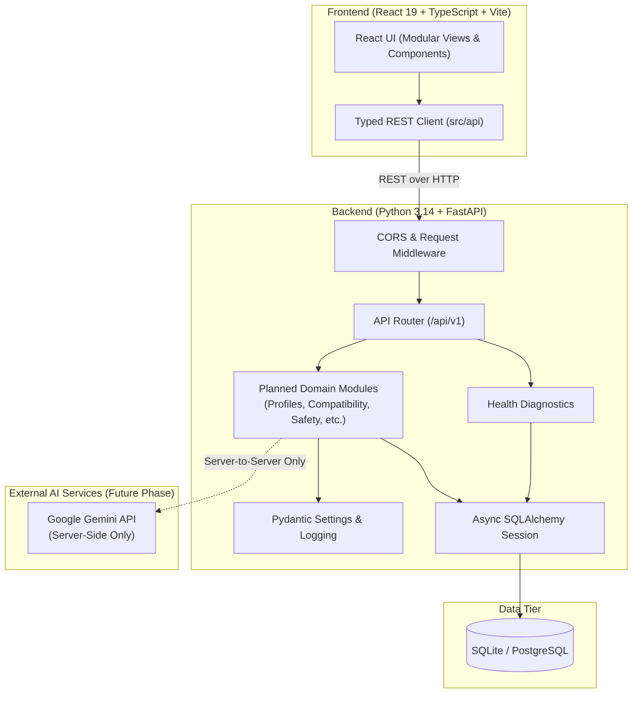

# AI Dating Platform - System Architecture

## 1. Product Philosophy & Architectural Goals
The **AI Dating Platform** is engineered around relationship depth, authenticity, safety, and mutual compatibility rather than endless gamified swiping or engagement maximization.

Key architectural pillars:
* **Privacy & Trust-by-Design**: User data and sensitive signals are guarded behind strict server-side boundaries. AI model keys (e.g., Google Gemini API) are strictly server-side and never exposed to the client.
* **Modular Domain Isolation**: Core platform subsystems (Profiles, Compatibility, Simulation, Chat Intelligence, Safety) are developed as decoupled modules with distinct schemas and business logic.
* **Database Agility**: Local rapid development runs on SQLite with async I/O (`sqlite+aiosqlite`), while the schema, session lifecycle, and ORM abstractions are 100% compliant with PostgreSQL (`postgresql+asyncpg`) for production scale.
* **Observable & Resilient**: Standardized structured JSON responses, health-checks with live database ping, and centralized error handling across all endpoints.

---

## 2. High-Level System Architecture



---

## 3. Database Layer & Migration Strategy

### Current Foundation: SQLite (Async)
* Engine protocol: `sqlite+aiosqlite:///{DB_PATH}`
* Enforces foreign key support on SQLite connections via event listeners.
* Ideal for local development, zero external daemon requirements, and sub-millisecond local latency.

### Transition Path: PostgreSQL (Async)
* Engine protocol: `postgresql+asyncpg://{USER}:{PASSWORD}@{HOST}:{PORT}/{DB_NAME}`
* Because models inherit from standard SQLAlchemy 2.0 `DeclarativeBase` and use standard column types, migration only requires:
  1. Updating the `DATABASE_URL` environment variable to a PostgreSQL connection string.
  2. Running Alembic migrations against the PostgreSQL instance.
  3. No changes to API routes, services, or repository abstractions.

---

## 4. API Design & Error Envelope

All API endpoints follow RESTful standards and are versioned under `/api/v1`.

### Success Response (Standard)
```json
{
  "status": "healthy",
  "service": "ai-dating-platform-api",
  "environment": "development",
  "database": {
    "connected": true,
    "dialect": "sqlite"
  },
  "timestamp": "2026-11-20T11:20:00.000000Z"
}
```

### Standard Error Response Envelope
```json
{
  "error": {
    "code": "VALIDATION_ERROR | NOT_FOUND | INTERNAL_ERROR",
    "message": "Human-readable description of error",
    "details": []
  }
}
```

---

## 5. Security & Secret Hygiene Architecture

1. **Client Isolation**: The React frontend only knows `VITE_API_BASE_URL`. Under no circumstances are third-party credentials (like Gemini API keys) compiled into the frontend bundle.
2. **CORS Governance**: Backend strictly restricts CORS origins based on `BACKEND_CORS_ORIGINS` configured in `.env`.
3. **Environment Segregation**:
   * `backend/.env.example` documents backend configurations.
   * `frontend/.env.example` documents frontend configurations.
   * Real `.env` files are ignored by git.

---

## 6. Planned Subsystems Roadmap
1. **AI-Powered Profile Intelligence**: Multi-dimensional value extraction, values & goals alignment.
2. **AI Compatibility Engine**: Multi-factor psychological and lifestyle compatibility matching.
3. **Relationship Compatibility Simulator**: Simulated interaction dynamics across common real-world scenarios.
4. **Dating-Specific AI Assistant**: Pre-date preparation, conversational coaching, and reflection tools.
5. **Chat Intelligence**: Empathy indicators, conversation momentum, and sentiment insights.
6. **Meaningful Date Planner**: Personalized date concepts based on shared interests and low-pressure settings.
7. **Dating Safety Intelligence**: Fake profile detection, scam warning flags, harassment filtering, and consent-based photo protection.
